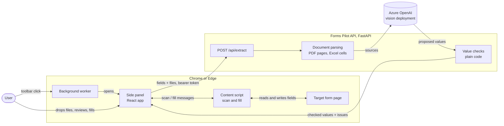

# Forms Pilot internals

How Forms Pilot is wired, for maintainers and agents. The [project README](../README.md) covers using and running it; these pages explain how the parts connect and why.

## The system on one page

1. The side panel asks the content script to **scan** the page. The scan returns the fields of the form the page's profile describes.
2. The user drops images, PDFs or `.xlsx` workbooks. The panel sends the fields and files to `POST /api/extract`.
3. The API turns the files into **sources**: an image, a rendered PDF page, or the cells of one Excel sheet. It sends the sources to the vision model with the fields.
4. Plain code checks every value the model proposed. Values that fail a check become **issues** the user sees.
5. The user reviews and edits the values. The panel asks the content script to **fill** the page. Nothing is ever submitted.

## Pages

| Page | What it explains |
| --- | --- |
| [Architecture](architecture.md) | Components, the OpenAPI contract between them, trust boundaries and where state lives. |
| [Extension](extension.md) | Entrypoints, the side panel ↔ content script message protocol, side panel states, file preparation, scanning, filling and form profiles. |
| [API](api.md) | Routes, the extract request pipeline, auth and rate limiting, status codes and the request/response schema. |
| [Extraction](extraction.md) | How documents become sources, every limit and where it is enforced, the model call and the value checks. |
| [API client generation](api-client.md) | How `pnpm gen:api` turns the FastAPI app into the extension's typed client, and the TypeScript 7 patch. |
| [Development](development.md) | Local setup, the dev topology, commands, the test map and CI. |
| [Deployment](deployment.md) | Running the API container, configuration, token lifecycle and distributing the extension. |

## Vocabulary

- **Form profile:** an entry in [`extension/lib/profiles.ts`](../extension/lib/profiles.ts) naming the URLs a form lives on, plus field hints, labels and ignored fields.
- **Field:** one fillable control (or radio group) found by scanning, identified by its field id.
- **Source:** one thing the model reads: an uploaded image, one PDF page, or one nonempty Excel sheet.
- **Issue:** a sentence explaining why a value needs the user's attention, produced by the server's checks.
- **Draft:** the values the user is about to fill, starting as what the model read.
