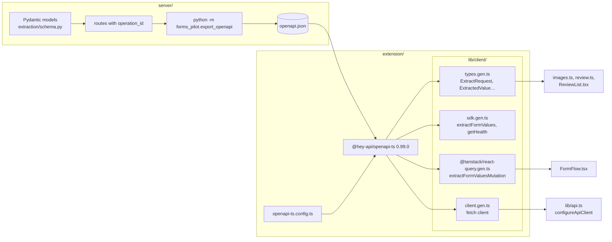
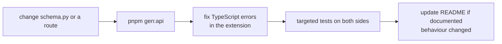

# API client generation

The extension's API client is generated from the FastAPI app, so the server's Pydantic models are the only declaration of the API.

`pnpm gen:api` at the repo root runs both steps. `pnpm dev:extension`, `pnpm build`, `pnpm zip` and `pnpm typecheck` run it first, so the client is always rebuilt from the current server. Both `server/openapi.json` and `extension/lib/client/` are gitignored; never edit them by hand.

## What drives the generated names

- Each route's `operation_id` becomes the SDK function and the TanStack helper names: `extractFormValues` → `extractFormValuesMutation`. Give every new route a clear, unique one.
- Pydantic model names become TypeScript type names.
- `require_caller` uses FastAPI's `HTTPBearer`, so the spec marks `extractFormValues` as needing bearer auth. The generated client calls the `auth` callback from `configureApiClient` only for those operations.

## Changing the API

## The TypeScript 7 patch

`@hey-api/openapi-ts` 0.99.0 prints code with the legacy TypeScript compiler API, which TypeScript 7 no longer ships. Two pieces work around it:

- [`pnpm-workspace.yaml`](../pnpm-workspace.yaml) adds `typescript-legacy` (an alias of `typescript@6.0.3`) as a dependency of the generator.
- [`patches/@hey-api__openapi-ts@0.99.0.patch`](../patches/@hey-api__openapi-ts@0.99.0.patch) points the generator at that alias.

Remove both together when upgrading to a generator that no longer needs the old API.
