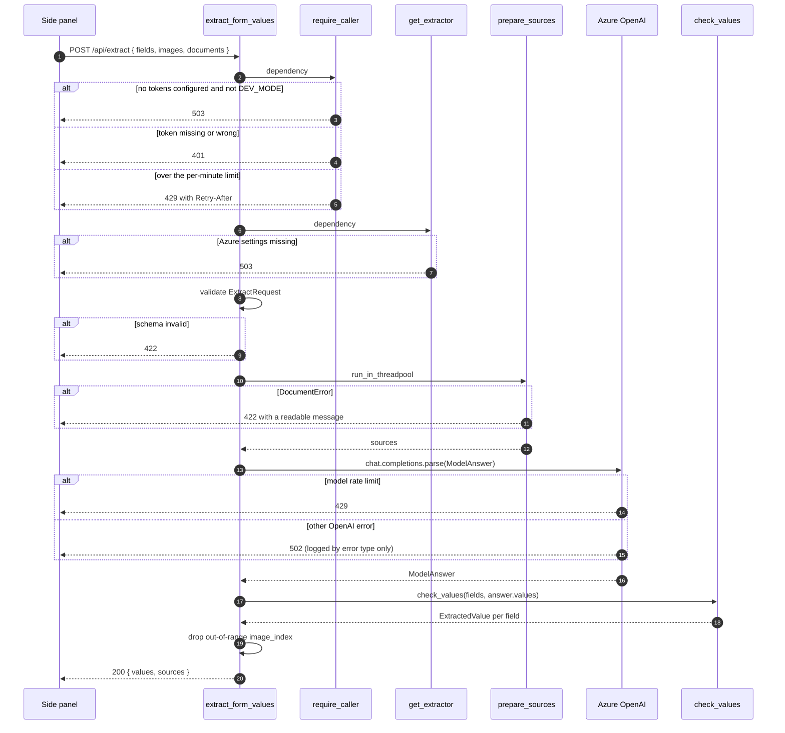
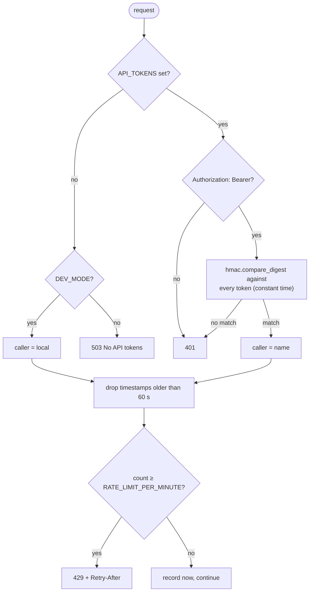
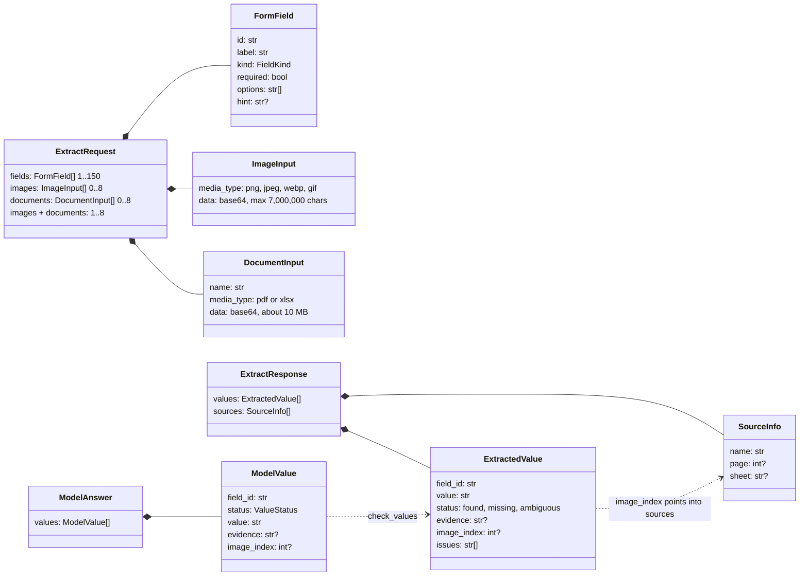

# API

A FastAPI app in [`main.py`](../server/src/forms_pilot/main.py) with three routers. Interactive docs are at `/docs`.

| Method and path | `operation_id` | Auth | Module |
| --- | --- | --- | --- |
| `GET /api/health` | `getHealth` | none | [`api/health.py`](../server/src/forms_pilot/api/health.py) |
| `POST /api/extract` | `extractFormValues` | bearer token, rate limit | [`api/extract.py`](../server/src/forms_pilot/api/extract.py) |
| `GET /sample-form` | not in the schema | none; `404` unless `DEV_MODE` | [`api/sample_form.py`](../server/src/forms_pilot/api/sample_form.py) |

## The extract request

Dependencies run before body validation errors are reported. A request with a valid token and an invalid body therefore gets `422`, but it still uses one of the caller's rate-limit slots.

Document parsing is CPU-bound, so it runs in the thread pool to keep the event loop free. After the checks, the route:

- clears `image_index` and adds an issue when the model pointed at a source that does not exist;
- rewords issues from "images" to "documents" when the request included documents.

## Auth and rate limiting

[`require_caller`](../server/src/forms_pilot/api/caller.py) returns the caller's name, which the route uses only for logs.

- Tokens come from `API_TOKENS` as `name:token` pairs; each token must be at least 32 characters. Parsing errors name the entry by position, never by content.
- The rate limit is a sliding 60-second window per caller, kept in process memory. Every server process (or replica) keeps its own.
- With `DEV_MODE` on and no tokens, everyone is `local` and shares one limit. Once tokens are set, `DEV_MODE` no longer bypasses auth.

## Status codes

| Code | Raised by | Meaning |
| --- | --- | --- |
| `200` | route | Values and sources returned. Issues may still be present. |
| `401` | `require_caller` | Token missing or unknown. The panel offers **Set your API token**. |
| `422` | FastAPI / `prepare_sources` | Request schema invalid, or a document is invalid, damaged or over a limit. |
| `429` | `require_caller` / route | Caller over their limit, or Azure OpenAI rate-limited the model call. |
| `502` | route / extractor | The model call failed, or returned no parsed answer. |
| `503` | `require_caller` / `get_extractor` | No tokens and not in dev mode, or Azure OpenAI is not configured. |

## Schema

Defined in [`extraction/schema.py`](../server/src/forms_pilot/extraction/schema.py) and exported to the extension through OpenAPI.

`ModelAnswer` and `ModelValue` are internal: they are the structured-output shape the model must return and are not part of the API. Every property is required there because structured output needs that; "nothing" is an empty string or `null`.

`image_index` keeps its name from the image-only version of the API. It now indexes `response.sources`, so older image-only clients keep working.
