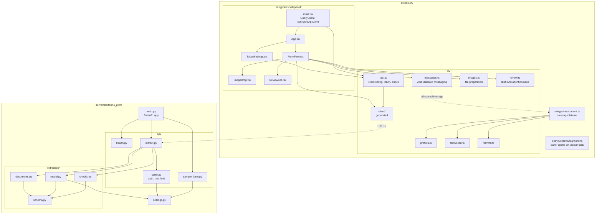
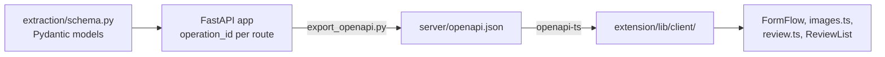
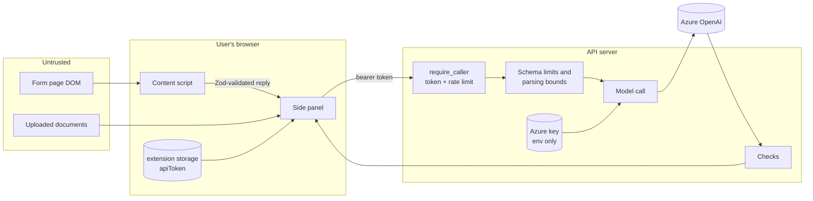

# Architecture

Forms Pilot is two deployables in one pnpm + uv workspace:

| Part | Stack | Runs where |
| --- | --- | --- |
| [`extension/`](../extension) | WXT (Manifest V3), React 19, TypeScript, Tailwind, TanStack Query, Zod | In each user's Chrome or Edge |
| [`server/`](../server) | Python 3.12+, FastAPI, Pydantic, PyMuPDF, openpyxl, OpenAI SDK | One container, behind HTTPS |

The extension never talks to the model. The server never talks to the form page.

## Modules and how they connect

Dashed arrows cross a process boundary: the side panel and content script run in different JavaScript worlds and share only messages, and the API is a separate server. `background.ts` has no imports; it only sets the panel behaviour.

## The contract: FastAPI is the source of truth

The server's Pydantic models define the API. The extension never declares API types by hand; it imports them from a client generated from the server's OpenAPI spec.

Both `server/openapi.json` and `extension/lib/client/` are gitignored and rebuilt by `pnpm gen:api`. Details in [API client generation](api-client.md).

The **field shape** crosses two boundaries and is declared twice on purpose:

| Boundary | Declared in | Why |
| --- | --- | --- |
| Content script → side panel | [`lib/form/schema.ts`](../extension/lib/form/schema.ts) (Zod) | Messages from another script are validated on arrival. |
| Side panel → API | [`extraction/schema.py`](../server/src/forms_pilot/extraction/schema.py) (Pydantic) | The API validates every request. |

The two must stay compatible: the panel sends the scanned `FormField[]` straight into the extract request. Field kinds (`text`, `textarea`, `number`, `date`, `email`, `tel`, `select`, `checkbox`, `radio`) are listed in both.

## Trust boundaries

- **Page → extension.** The content script only runs on profile URLs. Its replies are parsed with Zod in the panel. Filling only changes values; it never submits.
- **Extension → API.** The host permission is limited to the configured API origin (see [`wxt.config.ts`](../extension/wxt.config.ts)). The user's personal token lives in extension storage and is sent only to operations that declare bearer auth.
- **API → model.** Azure credentials exist only in the server's environment. Document text and filenames are untrusted: the model instructions say to treat all source content as data and ignore instructions inside it.
- **Model → user.** The model's output is not trusted either: [`checks.py`](../server/src/forms_pilot/extraction/checks.py) validates every value, and the API drops source references that point outside the request.
- **Logs.** Model errors are logged by type only, and token errors name the entry by position, so personal data and tokens stay out of logs.

## Where state lives

| State | Location | Lifetime |
| --- | --- | --- |
| Personal API token | Extension storage, key `local:apiToken` | Until the user removes it |
| Uploaded files, prepared as base64 | Side panel React state | Until **Start over**, **Clear files** or the panel closes |
| Extracted values, sources, user edits | Side panel React state (`review`) | Until **Change files**, **Start over** or the panel closes |
| Field id on each control | `data-forms-pilot-field` attribute on the page | Until the page re-renders; rescanned before each fill |
| Settings and tokens | Server environment / `.env` | Process lifetime (`get_settings` is cached) |
| Rate-limit windows | Server process memory | Per process; reset on restart |
| Uploaded documents | Server memory during one request | Never written to disk |

There is no database.
