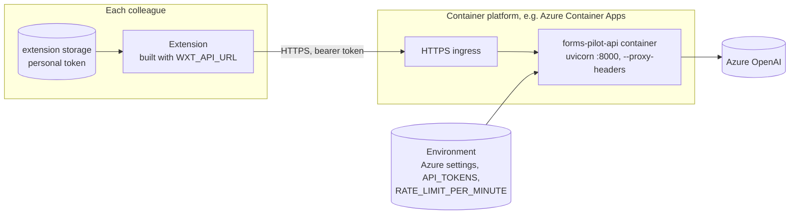
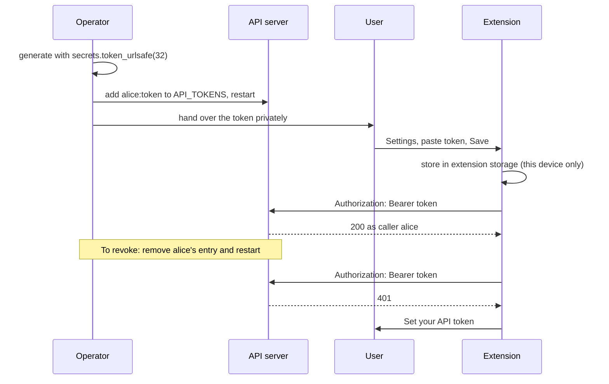
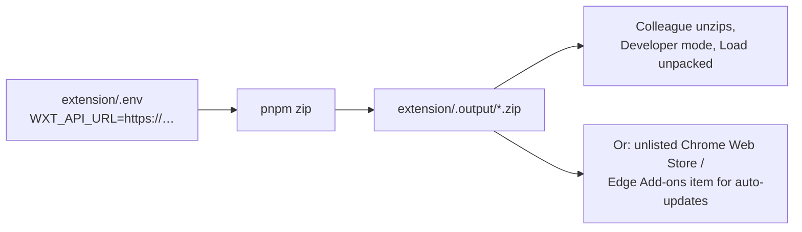

# Deployment

## Topology



The API needs no CORS settings: the side panel calls it through a host permission, which browsers exempt from CORS, and web pages are not meant to call it.

## The API container

[`server/Dockerfile`](../server/Dockerfile) builds from `python:3.13-slim`, installs locked dependencies with uv (no dev group), and runs as a non-root `app` user. Uvicorn trusts forwarded headers because it expects an HTTPS proxy or platform ingress in front.

```powershell
docker build -t forms-pilot-api server
docker run -p 8000:8000 --env-file .env forms-pilot-api
```

## Configuration

| Variable | Default | Effect |
| --- | --- | --- |
| `AZURE_OPENAI_ENDPOINT` | none | Resource URL. Without all three Azure settings, `/api/extract` returns `503`. |
| `AZURE_OPENAI_API_KEY` | none | Server-side only. |
| `AZURE_OPENAI_DEPLOYMENT` | none | A vision-capable chat deployment. |
| `API_TOKENS` | empty | `name:token,name:token`; tokens at least 32 characters. Empty means every extraction is refused, unless `DEV_MODE`. |
| `RATE_LIMIT_PER_MINUTE` | `10` | Extractions per caller per minute, per process. |
| `DEV_MODE` | `false` | Serves `/sample-form` and allows tokenless use when no tokens are set. Never on in production. |

Settings are read once per process; restart to apply changes.

## Token lifecycle



The rate limit is in memory per process. With several replicas or workers, a caller's effective limit is the setting times the number of processes.

## Distributing the extension



`WXT_API_URL` is baked in at build time: it sets both the client's base URL and the only host permission. Pointing the extension at another server means rebuilding it.
