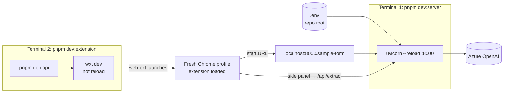
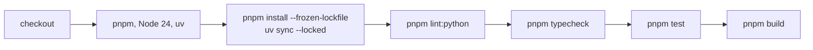

# Development

## Setup

Requirements: Node 22+ with pnpm, Python 3.12+ with [uv](https://docs.astral.sh/uv/).

```powershell
pnpm install                     # also runs `wxt prepare`
uv sync --directory server
Copy-Item .env.example .env      # fill in Azure OpenAI settings; keep DEV_MODE on
```

[`settings.py`](../server/src/forms_pilot/settings.py) reads `.env` from the working directory and its parent, so the root `.env` is found when the API runs from `server/`.

## Local topology



- `/sample-form` serves [`sample_form.html`](../server/src/forms_pilot/sample_form.html) only when `DEV_MODE` is on. It is a customs **General Information** screen; only step 1 exists, and **Next** validates locally and shows a demo message.
- `wxt dev` opens a separate Chrome profile. Without the `web-ext` dev dependency, WXT silently falls back to manual loading.
- `pnpm --filter @forms-pilot/extension dev:edge` targets Edge.
- Live extraction calls Azure OpenAI and costs money; tests never do.

## Commands

| Command | What it does |
| --- | --- |
| `pnpm dev:server` | API with reload on port 8000 |
| `pnpm dev:extension` | Regenerate the client, then run the extension in dev mode |
| `pnpm gen:api` | Export `openapi.json` and regenerate `extension/lib/client/` |
| `pnpm build` / `pnpm zip` | Production build or zip in `extension/.output/` |
| `pnpm typecheck` | Regenerate, `tsc --noEmit`, then Basedpyright |
| `pnpm test` | Vitest, then pytest |
| `pnpm lint:python` | `ruff check` and `ruff format --check` |

Targeted runs, preferred while working:

```powershell
uv run --directory server pytest tests/documents_test.py -q
uv run --directory server basedpyright src/forms_pilot/extraction/documents.py
pnpm --filter @forms-pilot/extension exec vitest run lib/form/fill.test.ts
pnpm --filter @forms-pilot/extension typecheck
```

## Test map

| Test | Covers |
| --- | --- |
| [`checks_test.py`](../server/tests/checks_test.py) | Value checks per field kind, IBAN checksum, missing and ambiguous values |
| [`documents_test.py`](../server/tests/documents_test.py) | Workbook cells and vehicle rows, scanned PDF rendering, invalid and oversized documents, a document-only request |
| [`extract_test.py`](../server/tests/extract_test.py) | The extract route with a fake extractor: checked values, invalid requests, model errors, auth, rate limit, token settings |
| [`health_test.py`](../server/tests/health_test.py) | Health route |
| [`sample_form_test.py`](../server/tests/sample_form_test.py) | Sample form served only in dev mode |
| [`api.test.ts`](../extension/lib/api.test.ts) | `ApiError` and user-facing error messages |
| [`images.test.ts`](../extension/lib/images.test.ts) | File preparation and the images/documents split |
| [`review.test.ts`](../extension/lib/review.test.ts) | Draft, attention rules and fill summary |
| [`scan.test.ts`](../extension/lib/form/scan.test.ts) | Scanning, against the real sample form via [`fixture.ts`](../extension/lib/form/fixture.ts) |
| [`fill.test.ts`](../extension/lib/form/fill.test.ts) | Filling each control kind and the outcomes |

Backend tests override settings through the `use_settings` fixture in [`conftest.py`](../server/tests/conftest.py), which ignores any local `.env`. Extension tests run in `happy-dom`. Customer documents are never used as fixtures.

## CI

[`.github/workflows/ci.yml`](../.github/workflows/ci.yml) runs on every pull request and on pushes to `main`:



Lockfiles must be current: CI fails if `pnpm-lock.yaml` or `server/uv.lock` is out of date.
