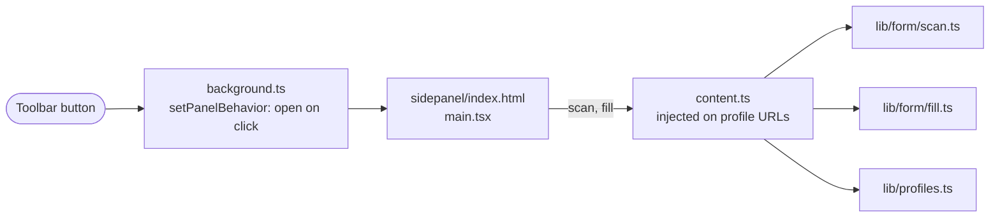
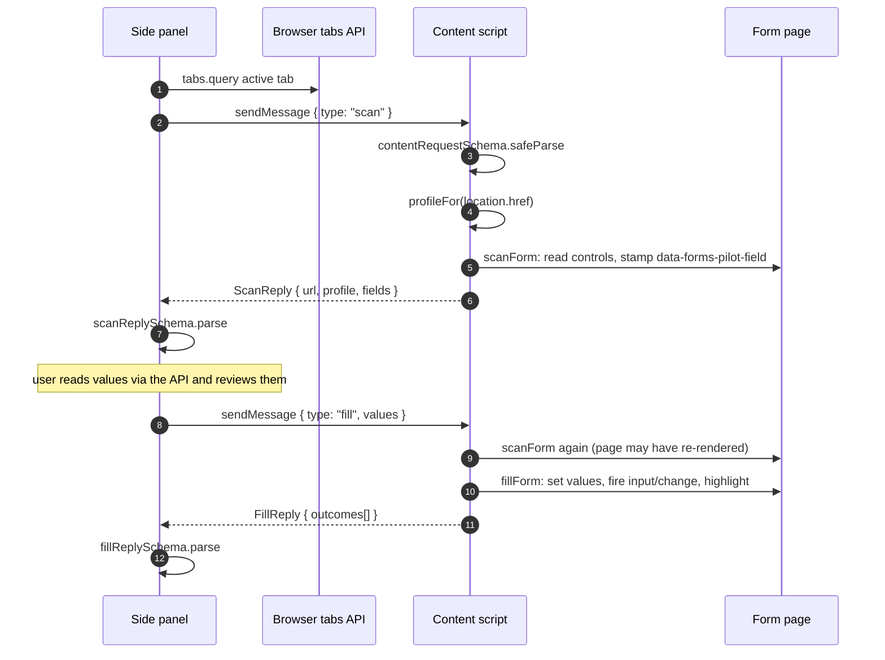
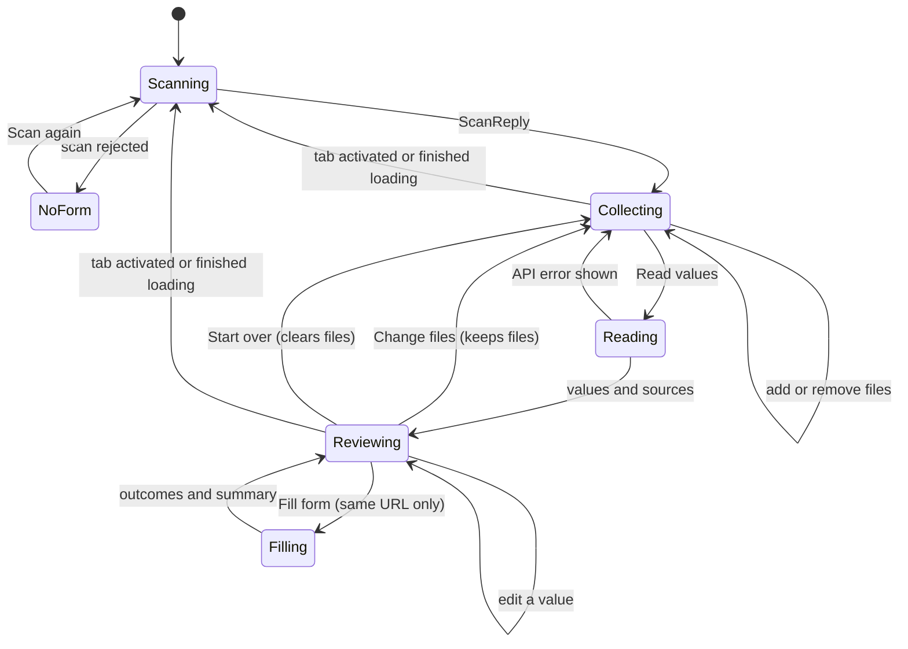
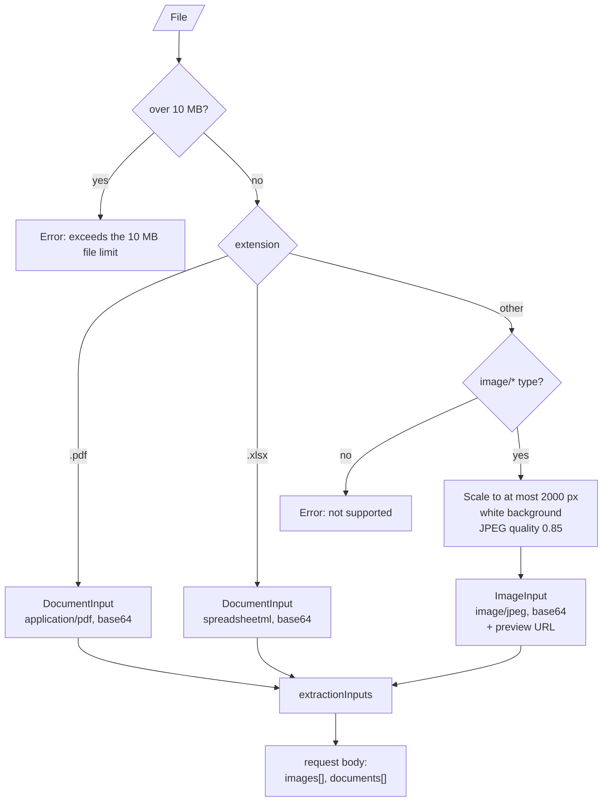
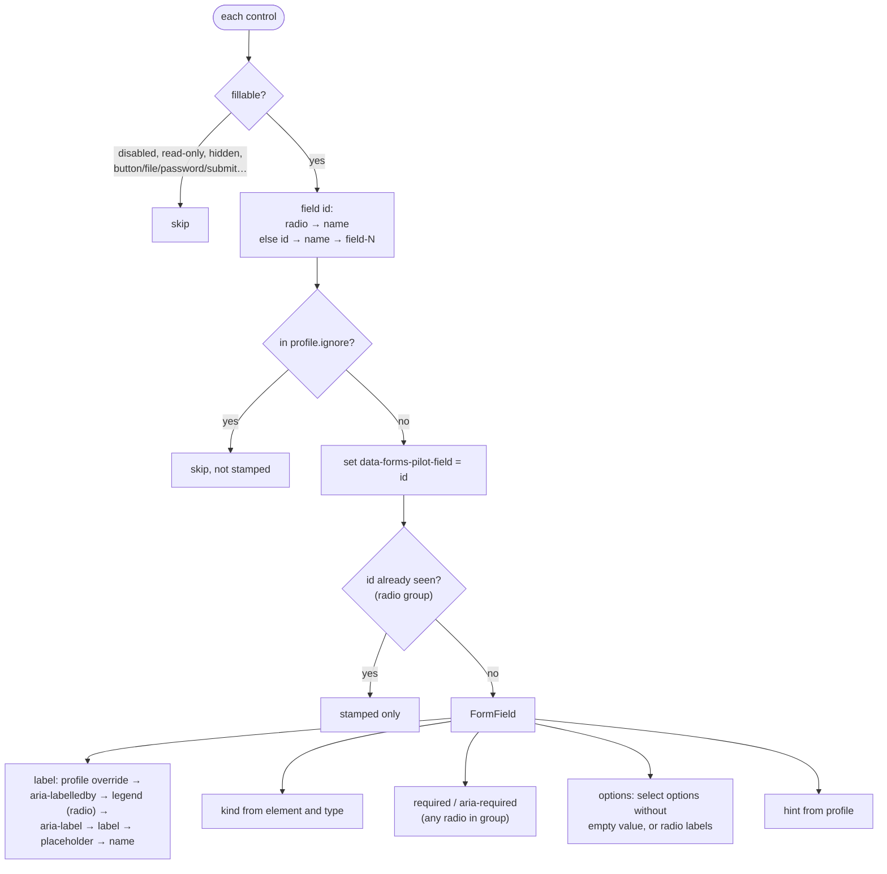
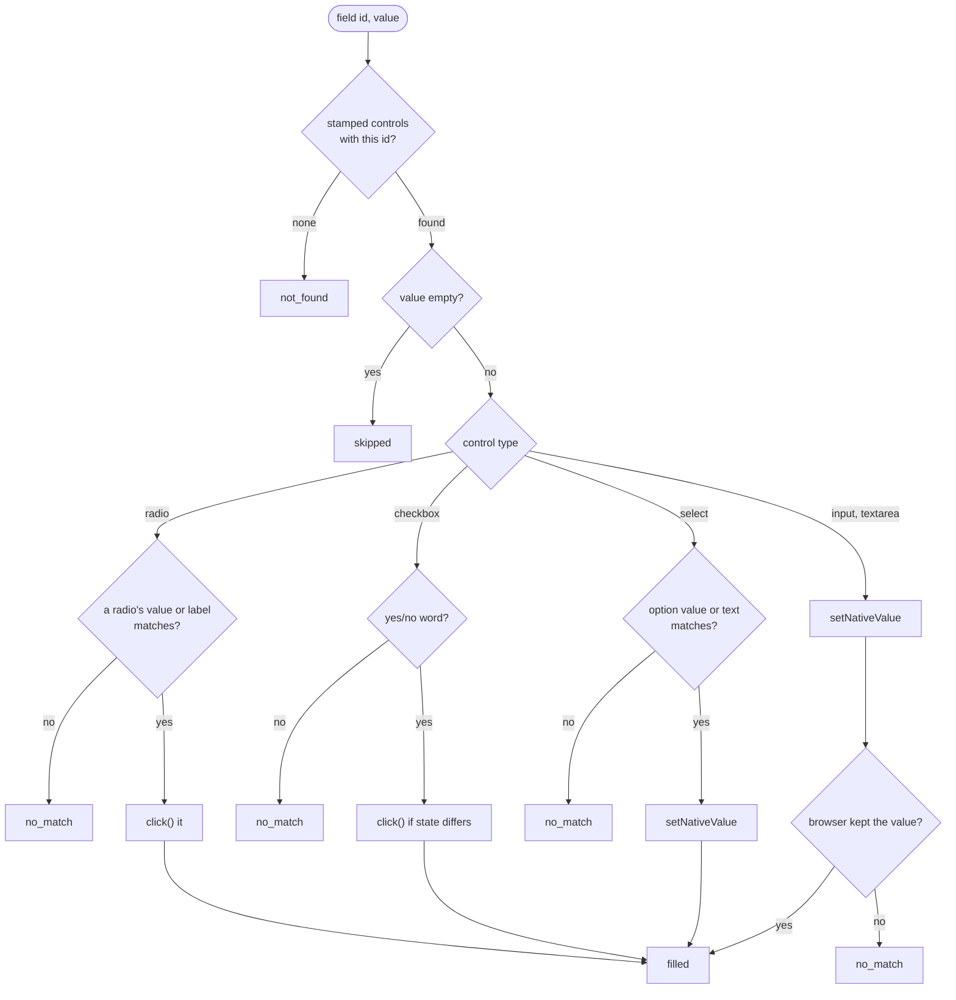
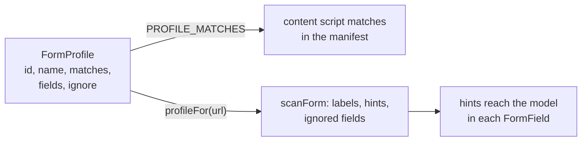

# Extension

A Manifest V3 extension built with [WXT](https://wxt.dev). Its manifest is generated from [`wxt.config.ts`](../extension/wxt.config.ts):

- **Permissions:** `sidePanel`, `activeTab`, `storage`.
- **Host permissions:** only the API origin from `WXT_API_URL` (default `http://localhost:8000`). Extension pages with a host permission call the API without CORS.
- **Content script matches:** every pattern in every [form profile](#form-profiles).

## Entrypoints

| Entrypoint | Job |
| --- | --- |
| [`background.ts`](../extension/entrypoints/background.ts) | Makes the toolbar button open the side panel, so the panel stays next to the form. |
| [`content.ts`](../extension/entrypoints/content.ts) | Answers `scan` and `fill` messages on pages that match a profile. Highlights filled controls for 4 seconds. |
| [`sidepanel/`](../extension/entrypoints/sidepanel) | The React app: token settings, file drop, review and fill. |

## Message protocol

The side panel and content script share nothing but messages. [`lib/messages.ts`](../extension/lib/messages.ts) defines both sides with Zod, and every message and reply is validated on arrival.

If no content script answers (the page has no profile, or it was open before the extension was installed), `sendMessage` rejects and the panel shows `NoFormError`: *"Forms Pilot does not support this page."*

## Side panel states

[`FormFlow.tsx`](../extension/entrypoints/sidepanel/FormFlow.tsx) holds the whole flow. The scan is a TanStack query (`["scan"]`); reading values and filling are mutations. Retries are off, so a failed scan reports immediately.

The rescan on tab change only updates the scanned form. An open review survives it, but **Fill form** is disabled while the active tab's URL differs from the URL the values were read for.

**Settings** is an overlay. [`App.tsx`](../extension/entrypoints/sidepanel/App.tsx) hides `FormFlow` instead of unmounting it, so files and edits survive a visit. A `401` from the API shows a **Set your API token** button that opens it.

## Preparing files

[`lib/images.ts`](../extension/lib/images.ts) turns dropped or picked files into request inputs. The picker accepts `image/*,.pdf,.xlsx`; at most 8 files per request.

`extractionInputs` sends all images in `images` and all PDFs and workbooks in `documents`. The server numbers sources images first, so source order is not upload order (see [Extraction](extraction.md#how-sources-are-numbered)).

## Scanning

[`scanForm`](../extension/lib/form/scan.ts) walks every `input`, `textarea` and `select`:

The `data-forms-pilot-field` stamp is how filling finds controls again without selectors.

## Filling

[`fillForm`](../extension/lib/form/fill.ts) receives only non-empty values ([`valuesToFill`](../extension/lib/review.ts)), so filling never clears what the user typed. Each value gets one outcome:

Matching ignores case but not accents. `setNativeValue` calls the prototype's `value` setter and dispatches `input` and `change`, which keeps React, Vue and Angular forms in sync; checkboxes and radios use `click()` for the same reason. [`fillSummary`](../extension/lib/review.ts) turns outcomes into the message under the button.

## Reviewing

[`lib/review.ts`](../extension/lib/review.ts) holds the rules [`ReviewList.tsx`](../extension/entrypoints/sidepanel/ReviewList.tsx) shows:

- The **draft** starts as the extracted values; edits change it.
- A field **needs attention** when the model said `ambiguous` or a check produced issues, unless the user already edited it.
- Evidence is shown as *Read "…" in invoice.pdf, page 2* or *in vehicles.xlsx, sheet Sheet1*, from `response.sources[image_index]`.

## Form profiles

[`lib/profiles.ts`](../extension/lib/profiles.ts) is the only place that knows about specific forms.

Adding a form means adding a profile; the content script is not injected anywhere else. Field ids come from the page (`id`, or `name` for radio groups), so a profile never needs selectors. The current profile, `sample-customs`, matches the local [`/sample-form`](../server/src/forms_pilot/sample_form.html) and ignores `mra_aeo`.

## API client and token

[`configureApiClient`](../extension/lib/api.ts) runs once in `main.tsx`:

- `baseUrl` is `WXT_API_URL`, falling back to `http://localhost:8000`. The same value sets the host permission in `wxt.config.ts`; keep the two fallbacks in step.
- `auth` reads `apiToken` from extension storage for every request to an operation that declares bearer auth.
- An error interceptor turns any HTTP error into `ApiError`, using FastAPI's `detail` when it is a sentence. A `TypeError` from `fetch` means the server could not be reached.
