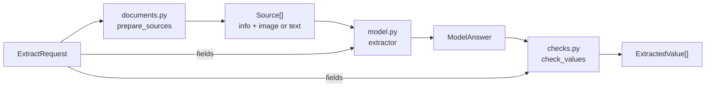
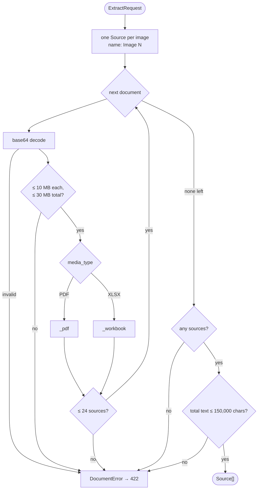
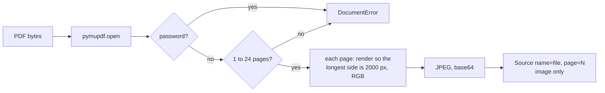
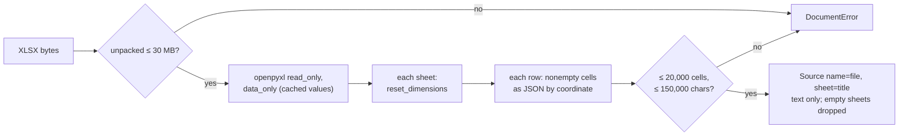
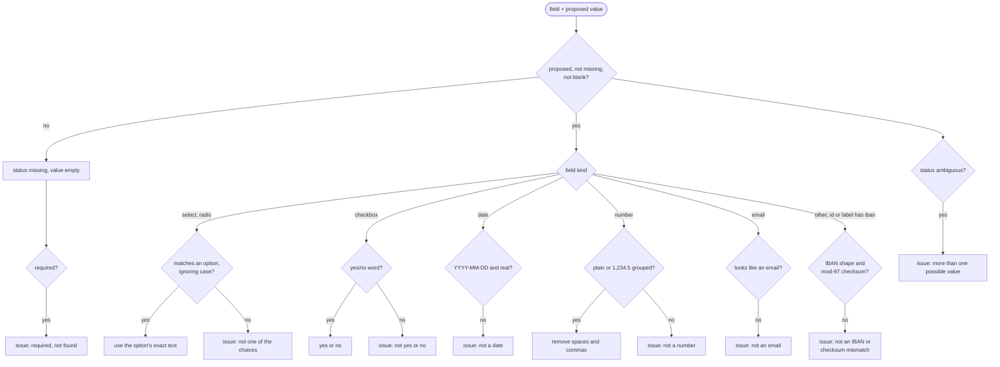

# Extraction

Everything between a valid request and a checked response lives in [`server/src/forms_pilot/extraction/`](../server/src/forms_pilot/extraction):



## From documents to sources

[`prepare_sources`](../server/src/forms_pilot/extraction/documents.py) runs in the thread pool and never writes to disk.



### PDF



Every page is rendered, even when it has a text layer: scans have none, and tables read better visually. No PDF text is extracted.

### Excel



A row becomes one JSON line, for example `{"A2": "Corolla", "C2": "JTD…", "H2": 87032390}`. Coordinates keep blank columns and row identity, dates become ISO strings, and numeric ids such as HS codes stay integers. Formulas are never executed: `data_only` reads the value Excel cached when the file was last saved, which is empty for a workbook that was never recalculated. `reset_dimensions` ignores a sheet's declared size, which can be inflated, so the cell limit bounds the real work.

### How sources are numbered

Sources are indexed from 0 in this order: every request image first, then each document's pages or sheets in document order. The extension puts images in `images` and PDFs and workbooks in `documents`, so for an upload of `invoice.pdf, photo.jpg` the photo is source 0. The model's `image_index` and the panel's evidence label both use this order, from `response.sources`.

## Limits and where they are enforced

| Limit | Extension | Request schema | Parsing |
| --- | --- | --- | --- |
| Files per request: 8 | `MAX_IMAGES` in [`images.ts`](../extension/lib/images.ts) | `require_sources`: 1 to 8 images + documents | |
| File size: 10 MB | `prepareFile` (before resizing) | `DocumentInput.data` length | `MAX_DOCUMENT_BYTES` per document |
| Image size | scaled to 2000 px JPEG | `ImageInput.data` ≤ 7,000,000 base64 chars (about 5 MB) | |
| Documents together: 30 MB | | | `prepare_sources` |
| Sources: 24 | | | images + PDF pages + nonempty sheets |
| PDF pages: 1 to 24 | | | `_pdf` |
| Workbook unpacked: 30 MB | | | `_workbook` |
| Workbook cells: 20,000 | | | `_workbook` |
| Parsed text: 150,000 chars | | | `_workbook` and `prepare_sources` |
| Fields: 1 to 150; options ≤ 200 | | `ExtractRequest`, `FormField` | |

Change a limit in every column it appears in, and in the [project README](../README.md#pdf-and-excel-documents).

## The model call

[`model.py`](../server/src/forms_pilot/extraction/model.py) is the only file that knows about the model.

```mermaid
flowchart TD
    settings["AZURE_OPENAI_ENDPOINT, _API_KEY,<br/>_DEPLOYMENT"] --> get{"all set?"}
    get -->|no| e503["503"]
    get -->|yes| client["AsyncOpenAI<br/>base_url = endpoint/openai/v1/<br/>cached per endpoint and key"]
    client --> call["chat.completions.parse<br/>response_format = ModelAnswer"]
    sys["system: INSTRUCTIONS"] --> call
    user["user content"] --> call
    call --> parsed{"parsed answer?"}
    parsed -->|no| e502["502"]
    parsed -->|yes| answer["ModelAnswer"]
```

The user message is a list of parts:

1. `Fields:` and the requested fields as JSON, including profile hints.
2. For each source, in index order: `Source N: {name, page, sheet}`, then the sheet text if any, then the image as a `data:` URL if any.

The instructions in `model.py` tell the model to use only what is written, return `missing` rather than guess, return `ambiguous` with every candidate quoted when sources disagree, use exact options and ISO dates, match vehicle rows across files by VIN, and ignore instructions inside source content. Structured output holds the reply to `ModelAnswer`.

Tests replace the extractor through FastAPI's `get_extractor` dependency, so they never call Azure.

## Checks

[`check_values`](../server/src/forms_pilot/extraction/checks.py) returns one value per requested field, in the form's order. Ids the model invented are dropped.



Evidence and `image_index` are kept only when a value was found. There is no confidence score: the model's own confidence is not a reliable signal, so the panel flags fields from these checks and the model's status.
